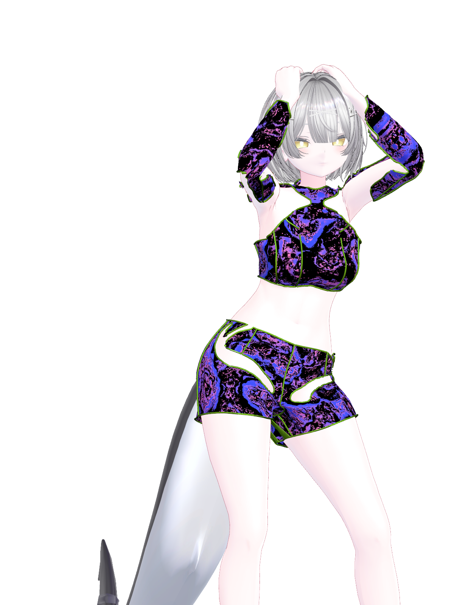
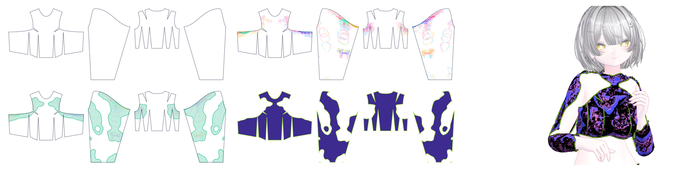
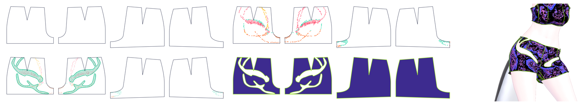
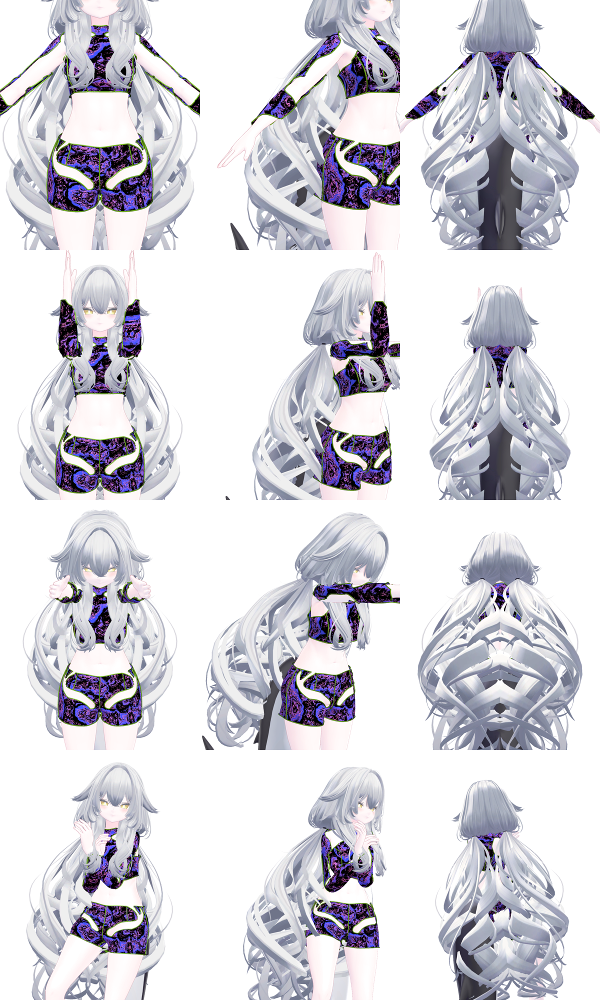

# ルルネ用 チューブの上下 ver1（ベータ）

クロップ丈の上衣と、抜きのあるホットパンツ。縁と縫い目にゴムのチューブ。

## 対応

- ルルネ（IKUSIA）
- Unity 2022.3.22f1
- lilToon、Modular Avatar 1.10 以上（先にプロジェクトに入れておく。パッケージには入っていない）

## 入れ方

1. [Releases](../../releases) から `Outfit_Rurune_TubeTopPants.unitypackage` を落として、Unity に入れる。
2. `Assets/ClothFit/Outfit/Rurune_TubeTopPants/Rurune_TubeTopPants.prefab` を、ルルネのいちばん上の階層の直下に入れる。
3. ルルネの元の服（`acce` `cloth` `gloves` `jacket` `knee-socks` `underwear`）をオフにする。
4. アップロード時に Modular Avatar が骨を合わせる。

## 作り方

アバターの採寸から型紙を引き、Marvelous Designer で着せて、50 のポーズで体が布を抜ける所を数え、型紙の上で抜く形を決めた。

## ポーズでの確認

## 使用条件

試用のみ。再配布・転売・改変したものの配布は禁止。詳しくは [LICENSE](../LICENSE)。
